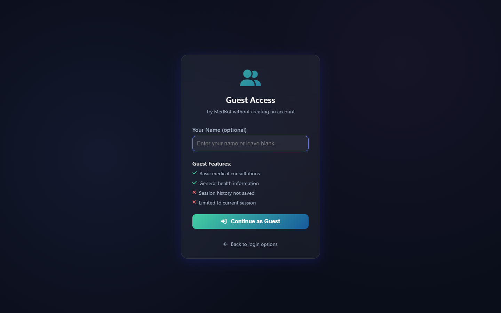
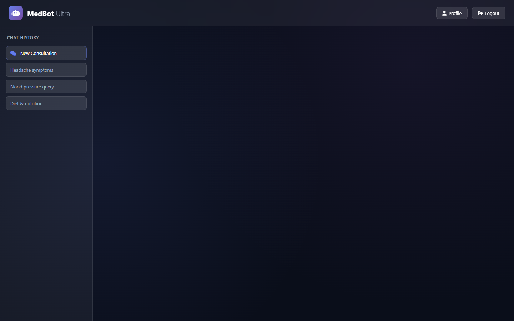
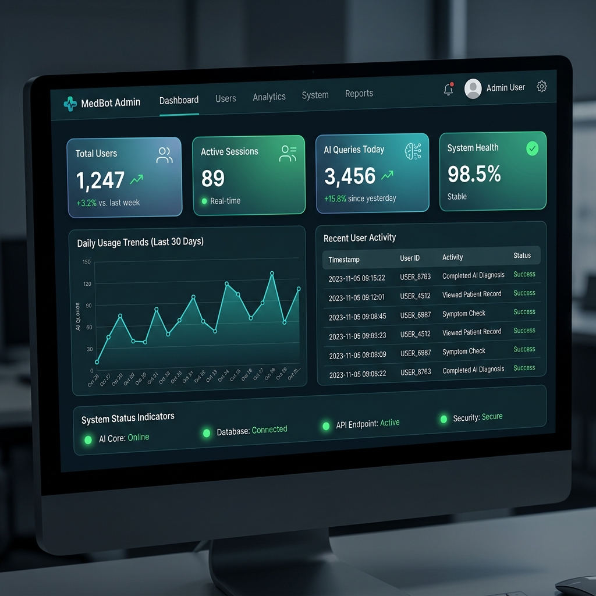
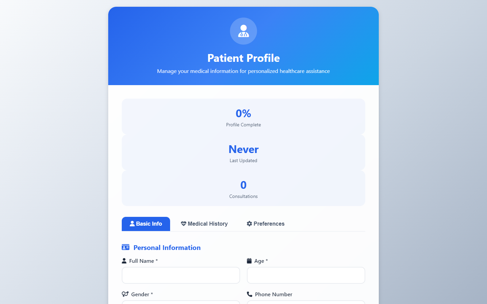
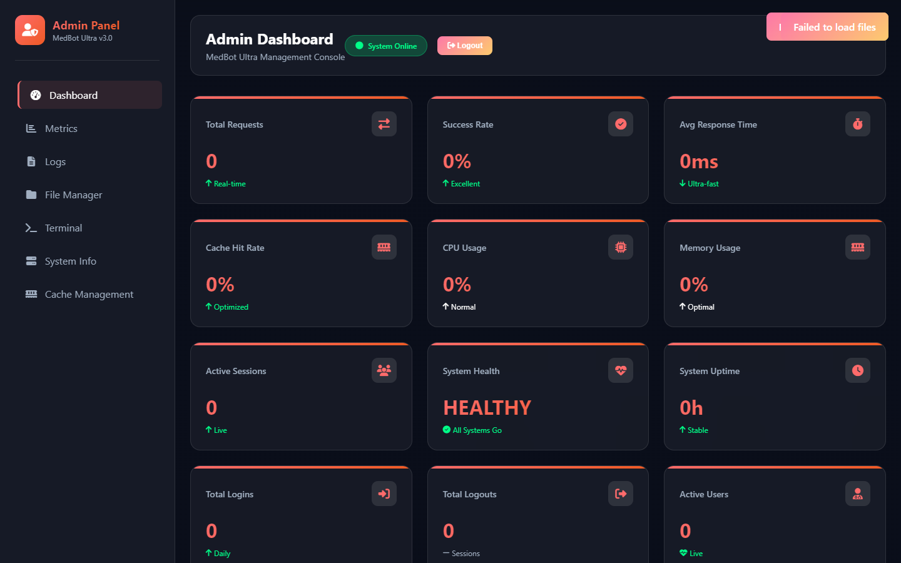

# MedBot — AI Medical Diagnostic Assistant

A full-stack AI medical assistant that combines LLM inference, retrieval-augmented generation over indexed medical textbooks, and patient health profiling to deliver personalised diagnostic support.

---

> **Medical Disclaimer**
>
> **Not for clinical use. Research and educational prototype.**
>
> MedBot does not prescribe medication, provide diagnoses, or replace professional medical advice. All outputs are for educational and research purposes only. Do not use this tool to make healthcare decisions.

---

## Screenshots

| Login | Chat Interface | Dashboard |
|:-:|:-:|:-:|
|  |  |  |

| Patient Profile | Admin Dashboard |
|:-:|:-:|
|  |  |

---

## What It Does

MedBot accepts free-text symptom descriptions, retrieves relevant passages from a Pinecone-indexed vector store built on medical textbooks, and generates a structured diagnostic response via a Groq-hosted LLaMA model. Responses are personalised using the authenticated user's stored health profile (chronic conditions, allergies, medications, BMI, lifestyle factors).

### Architecture

```
┌──────────────────────────────────────────────────────────────────┐
│                        Client (Browser)                         │
│                  Jinja2 Templates + Vanilla JS                  │
└──────────────────────┬───────────────────────────────────────────┘
                       │ HTTP / WebSocket
┌──────────────────────▼───────────────────────────────────────────┐
│                   FastAPI Application Server                     │
│  ┌─────────────┐  ┌──────────────┐  ┌─────────────────────────┐ │
│  │ Auth Layer  │  │ Chat Engine  │  │ Admin Panel & Metrics   │ │
│  │ (OAuth/JWT) │  │ (LLM + RAG) │  │ (Real-time monitoring)  │ │
│  └──────┬──────┘  └──────┬───────┘  └────────────┬────────────┘ │
│         │                │                       │              │
│  ┌──────▼──────┐  ┌──────▼───────┐  ┌────────────▼────────────┐ │
│  │  Security   │  │  AI Engine   │  │  Clinical Decision      │ │
│  │  Manager    │  │  (Groq LLM   │  │  Support System         │ │
│  │  (AES-256)  │  │  + Pinecone) │  │  (Differential Dx)      │ │
│  └─────────────┘  └──────┬───────┘  └─────────────────────────┘ │
│                          │                                      │
│  ┌───────────────────────▼──────────────────────────────────────┐│
│  │              Medical Vision Pipeline (CUDA)                  ││
│  │  OCR · Image Enhancement · Document Classification           ││
│  └──────────────────────────────────────────────────────────────┘│
└──────────────────────┬──────────────────────────────────────────┘
                       │
       ┌───────────────┼───────────────┐
       │               │               │
┌──────▼──────┐ ┌──────▼──────┐ ┌──────▼──────┐
│  Supabase   │ │   Redis     │ │  Pinecone   │
│ (PostgreSQL │ │ (Cache +    │ │ (Vector DB  │
│  + RLS)     │ │  Sessions)  │ │  for RAG)   │
└─────────────┘ └─────────────┘ └─────────────┘
```

---

## Key Features

### AI and Diagnostics
- **Symptom analysis and triage** — detects symptom patterns, classifies urgency levels (routine → semi-urgent → urgent → emergency), and generates structured diagnostic follow-up questions.
- **Medical literature retrieval (RAG)** — queries a Pinecone vector index built from medical textbooks to ground every response in textbook evidence.
- **Patient-aware responses** — integrates the user's stored health profile (chronic conditions, allergies, medications, BMI, sleep cycle, risk factors) to personalise diagnostic output.
- **Health risk scoring** — computes a composite risk score from age, pre-existing conditions, medications, and lifestyle factors.
- **Clinical decision support** — structured differential diagnosis generation with ICD-10 mapping, evidence grading, and recommended workup.

### Medical Vision and OCR
- **Medical image analysis** — GPU-accelerated (CUDA) processing pipeline for X-rays, prescriptions, lab reports, skin conditions, and medical documents.
- **Medical OCR** — Tesseract-based text extraction from prescriptions and clinical documents with medical-domain optimisations.

### Platform and Security
- **Multi-provider authentication** — Google OAuth, GitHub OAuth, email/password, and guest access via Supabase Auth.
- **Patient health profiles** — mandatory fields for weight, height, blood type, sleep cycle, emergency contact, chronic conditions, allergies, and medications with auto-calculated BMI.
- **Admin panel** — real-time metrics dashboard with user management, system health monitoring, and audit logs.
- **HIPAA-style audit logging** — SHA-256 session tracking with 7-year log retention policy.
- **Encryption** — AES-256-GCM data encryption, Argon2 password hashing, PBKDF2 key derivation.
- **Rate limiting and DDoS protection** — per-user and global rate limits backed by Redis.
- **Responsive UI** — works on desktop, tablet, and mobile devices.

---

## Tech Stack

| Layer | Technology |
|---|---|
| **Backend** | Python 3.10+, FastAPI, Uvicorn, Gunicorn |
| **AI / LLM** | Groq API (LLaMA inference), LangChain, SentenceTransformers |
| **Vector DB** | Pinecone (cosine similarity, dim 384) |
| **Database** | Supabase (PostgreSQL with Row Level Security) |
| **Cache** | Redis 7.x (sessions, rate limiting, AI response cache) |
| **Auth** | Google OAuth 2.0, GitHub OAuth, JWT, bcrypt, Argon2 |
| **OCR / Vision** | Tesseract, OpenCV, PyTorch, scikit-image, CUDA (optional) |
| **Encryption** | cryptography (Fernet, AES-256-GCM), PBKDF2 |
| **Monitoring** | Prometheus, Grafana, Fluent Bit |
| **Deployment** | Docker, Docker Compose, Nginx, Gunicorn |

---

## Run Locally

### Prerequisites

- Python 3.10+
- Redis server (running locally or via Docker)
- Supabase account (free tier works)
- Groq API key — free at [console.groq.com](https://console.groq.com)
- Pinecone account (free tier)

```bash
git clone https://github.com/sidduambesange06/medbot.git
cd medbot
python -m venv venv
venv\Scripts\activate   # Windows
source venv/bin/activate # Linux/macOS
pip install -r requirements.txt
cp .env.example .env
# Fill in .env with your credentials
uvicorn app_production:app --reload --host 0.0.0.0 --port 8080
```

> **Note:** The app requires live Supabase, Redis, Groq, and Pinecone credentials. It will not start without them.

The app runs at `http://localhost:8080`. Interactive API docs are at `http://localhost:8080/docs`.

---

## Configuration

All configuration is read from a `.env` file. Copy `.env.example` and fill in every value before starting the app.

| Key | Description |
|---|---|
| `SECRET_KEY` | Minimum 32-character random string used for session signing. Generate with `python -c "import secrets; print(secrets.token_hex(32))"` |
| `FLASK_ENV` | Application environment (`production` or `development`) |
| `FLASK_DEBUG` | Debug mode flag (`True` / `False`) |
| `SUPABASE_URL` | Your Supabase project URL (Settings > API) |
| `SUPABASE_KEY` | Supabase anon/public key |
| `SUPABASE_SERVICE_ROLE_KEY` | Supabase service role key (used for admin operations) |
| `GROQ_API_KEY` | Groq API key for LLM inference |
| `OPENAI_API_KEY` | Optional OpenAI API key (fallback LLM) |
| `PINECONE_API_KEY` | Pinecone API key |
| `PINECONE_ENVIRONMENT` | Pinecone environment (e.g. `us-east-1-gcp`) |
| `PINECONE_INDEX_NAME` | Name of your Pinecone index (`medical-chatbot-v2`) |
| `REDIS_URL` | Redis connection string (e.g. `redis://localhost:6379`) |
| `GOOGLE_CLIENT_ID` | Google OAuth client ID |
| `GOOGLE_CLIENT_SECRET` | Google OAuth client secret |
| `GITHUB_CLIENT_ID` | GitHub OAuth app client ID |
| `GITHUB_CLIENT_SECRET` | GitHub OAuth app client secret |
| `ADMIN_EMAIL` | Email address for the admin account |
| `ADMIN_PASSWORD` | Password for the admin account |
| `MEDAI_ENCRYPTION_KEY` | 32-byte hex key for AES-256 encryption of stored medical data |
| `RATE_LIMIT_CHAT` | Maximum chat requests per rate-limit window (default `50`) |
| `RATE_LIMIT_WINDOW` | Rate-limit window in seconds (default `3600`) |
| `MEDICAL_DOCS_PATH` | Path to the directory containing medical PDF textbooks (default `./data/`) |
| `EMBEDDING_MODEL` | SentenceTransformer model used for vector embeddings (default `sentence-transformers/all-MiniLM-L6-v2`) |
| `CHUNK_SIZE` | Token chunk size for PDF splitting (default `1000`) |
| `CHUNK_OVERLAP` | Overlap between adjacent chunks (default `200`) |

---

## Scope and Limitations

- **External services required.** The app depends on Supabase, Redis, Groq, and Pinecone. All four must be reachable at startup. There is no offline or mock mode.
- **Pre-built Pinecone index required.** The RAG pipeline reads from an existing index. You must create it yourself: index name `medical-chatbot-v2`, dimension `384`, metric `cosine`. The app does not build or populate the index automatically.
- **Medical PDFs not included.** The textbooks used to build the vector index are not in the repository (file size). Place your own PDF textbooks in `data/` and re-index them.
- **CUDA is optional.** The medical vision pipeline detects a CUDA-capable GPU at startup and falls back to CPU automatically if none is found. CPU inference is slower but fully functional.
- **Flask compatibility shims present.** The codebase includes Flask-compatible code alongside FastAPI. A full migration to pure FastAPI is not complete; both framework patterns coexist.
- **Not for clinical use. Research and educational prototype only.**

---

## Repository Structure

```
.
├── app_production.py                  # Main FastAPI application (routes, middleware, classes)
├── ai_engine/                         # AI diagnostic system
│   ├── intelligent_medical_system.py  #   Core symptom analysis and diagnosis engine
│   ├── intelligent_greeting.py        #   Context-aware greeting system
│   └── medical_books_intelligence.py  #   Medical textbook knowledge extraction
├── ai_vision/                         # Medical image analysis
│   └── cuda_medical_vision.py         #   GPU-accelerated vision pipeline
├── auth/                              # Auth decorators and helpers
├── auth_manager.py                    # Multi-provider OAuth management
├── clinical/                          # Clinical decision support
│   └── decision_support_system.py     #   Differential diagnosis, urgency triage
├── core/                              # App configuration
│   └── config.py                      #   Environment-based config management
├── database/                          # Data layer
│   ├── redis_manager.py               #   Redis connection pooling and caching
│   ├── user_manager.py                #   Authentication state management
│   └── sync_manager.py                #   Redis <-> Supabase sync
├── docs/
│   └── screenshots/                   # UI screenshots
├── src/                               # Prompt engineering
│   └── prompt_stable.py               #   Production medical prompt templates
├── static/                            # Frontend assets
│   └── js/medbot_enhanced.js          #   Client-side chat logic
├── templates/                         # Jinja2 HTML templates
│   ├── admin_dashboard.html           #   Admin metrics panel
│   ├── profile.html                   #   Patient health profile form
│   └── ...                            #   Login, error, OAuth callback pages
├── tests/                             # Test suite
├── data/                              # Medical textbooks (PDF, not included in repo)
├── security_manager.py                # AES-256 encryption and Argon2 hashing
├── supabase_manager.py                # HIPAA-compliant DB operations
├── redis_performance_manager.py       # AI response cache and rate limiting
├── enhanced_medical_vision.py         # Advanced medical image processing
├── supabase_schema.sql                # Database schema with RLS policies
├── supabase_encrypted_schema.sql      # Encrypted schema variant
├── docker-compose.production.yml      # Full production stack
├── gunicorn_config.py                 # Production WSGI configuration
├── book_registry.json                 # Indexed medical textbook registry
├── .env.example                       # Environment variable template
└── .gitignore
```

---

## API Overview

| Method | Endpoint | Description |
|---|---|---|
| `GET` | `/health` | Service health check |
| `POST` | `/chat` | Send a message to the AI diagnostic engine |
| `POST` | `/api/patient-profile` | Create or update patient health profile |
| `GET` | `/api/patient-profile` | Retrieve patient health profile |
| `POST` | `/auth/google` | Google OAuth login |
| `POST` | `/auth/email` | Email/password login |
| `GET` | `/history` | Paginated chat history |
| `POST` | `/analyze-image` | Medical image analysis (vision pipeline) |
| `GET` | `/admin/metrics` | Real-time platform metrics (admin only) |
| `GET` | `/docs` | Interactive Swagger API documentation |

---

Developed by Siddharoodh Ambesange.

Created for portfolio demonstration. Shared for educational purposes only.
